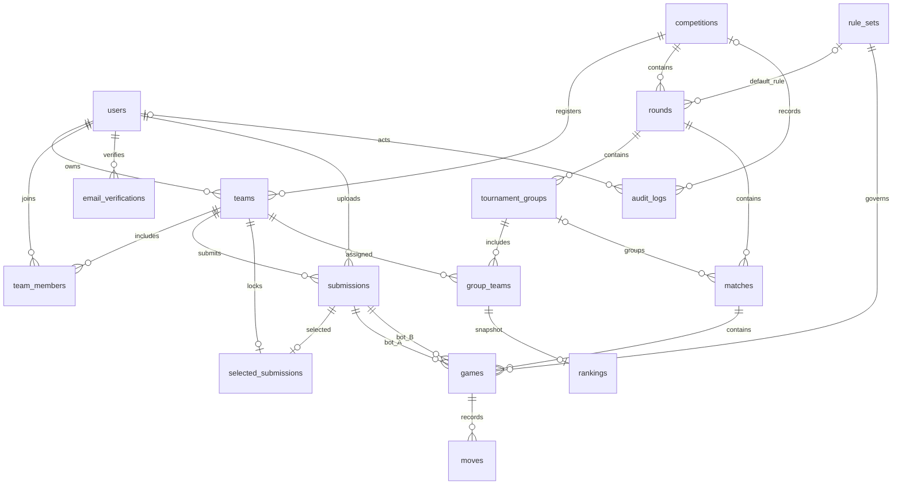

# Quan hệ dữ liệu BT3

Sơ đồ lược bớt các khóa ngoại đội A/B và winner để dễ đọc; schema.sql là đặc tả
chính xác của các cột và ràng buộc. Một đầu có thể chưa có bản ghi ở đầu nhiều,
ví dụ một Match PENDING chưa có Game. Knockout không cần Group.

Các khóa ghép bảo vệ quan hệ cùng giải, cùng vòng, cùng đội: không gắn một đội
của giải khác vào bảng/trận và không gắn Bot của đội khác vào Game. Hai màu có
thể đổi giữa các ván, còn team_a/team_b của Match cố định.

Tên đăng nhập duy nhất toàn database; tên đội duy nhất theo giải. student_code
và school_email duy nhất nếu có, nhưng việc xác minh danh tính là trách nhiệm
backend cùng quy trình của ban tổ chức. Thông tin xác nhận email chưa chứng minh
sinh viên đã đồng ý tham gia đội.
